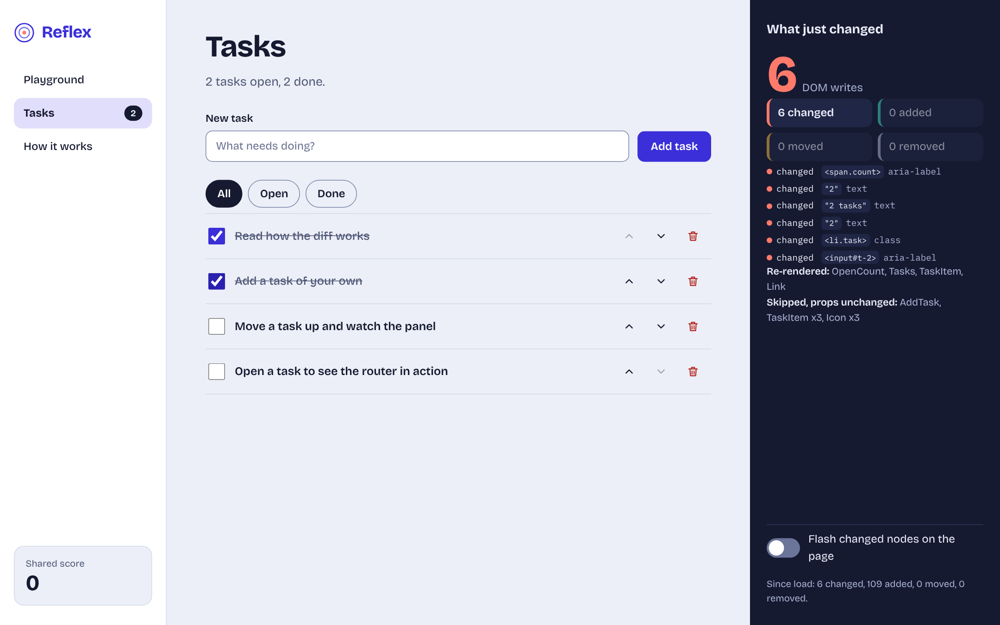

# Reflex

A small reactive UI library written from scratch in plain JavaScript. About 1,000 lines, no framework, no build step, no runtime dependencies.

It has a component model, state updates that re-render only what changed, event handling, and simple routing. The demo app in `demo/` is built with it and shows a live **"What just changed"** panel, so you can see exactly which DOM nodes each update touches.

> Built as Task 16 of the Varolline web developer internship: *Framework Concepts from Scratch*.



## Run it

You need Node 20 or newer.

```bash
npm install     # only installs jsdom, used by the tests
npm start       # demo at http://localhost:5173
npm test        # 64 tests, uses Node's built-in test runner
```

On Windows PowerShell use `npm.cmd start` and `npm.cmd test` if scripts are blocked.

The demo has to be served over HTTP because browsers do not load ES modules from `file://`. `npm start` runs a 30-line static server (`scripts/serve.js`), so nothing else is needed.

## What is in the box

| Requirement | Where | How |
|---|---|---|
| Component model | `src/vnode.js`, `src/core.js` | A component is a function from props to a tree. Hooks (`useState`, `useReducer`, `useEffect`, `useRef`, `useMemo`, `useCallback`) give it state and effects. |
| Re-render only what changed | `src/core.js` | `setState` marks one component dirty. A virtual DOM diff then writes only the differences to the real DOM. Components whose props did not change are skipped. |
| Event handling | `src/dom.js` | One native listener per event per element. It always calls the latest handler, so changing a handler costs no DOM work. |
| Simple routing | `src/router.js` | Hash routes (or the History API), `:params`, a `*` fallback, `Link`, `navigate`, `useRoute`. |
| Shared state | `src/store.js` | `createStore`, `useStore(selector)`, and `persist` to localStorage. |
| See it working | `src/debug.js` | `devtools` counts every DOM write. The demo's inspector reads it. |

## A tiny example

```js
import { tags, useState, createApp } from './src/index.js';
const { div, button, p } = tags;

function Counter() {
  const [n, setN] = useState(0);
  return div(
    p('Clicked ', n, ' times'),
    button({ onClick: () => setN(n + 1) }, 'Add one')
  );
}

createApp(Counter, document.getElementById('root'));
```

Click the button: Reflex changes one text node. The `div`, the `p`, and the `button` stay as they are.

There is no JSX because there is no build step. `h('div', props, ...children)` is the primitive, and `tags.div(props?, ...children)` is a shorthand over it.

## API

**Rendering**
- `h(type, props, ...children)` creates a vnode. `type` is a tag name, a component function, or `Fragment`.
- `tags.div(...)`, `tags.button(...)` and so on. The props object is optional.
- `createApp(Component, container, props)` mounts an app and returns `{ unmount }`.
- `render(vnode, container)`, `unmountRoot(container)`, `flushSync()`.
- `cx('a', cond && 'b')` joins class names.

**Props**
- `class` or `className`, `style` as an object or string, `value` and `checked` as controlled inputs, `ref`, `key`, `onClick`-style handlers, and `data-*`/`aria-*` attributes. SVG works too.
- Text is always inserted as a text node, never as HTML, so rendering user input is safe by default.
- Use `onInput` for live typing. `onChange` is the browser's native one and fires on blur for text inputs.

**Hooks**
- `useState(initial)` returns `[value, setValue]`. `setValue` accepts a value or `prev => next`.
- `useReducer(reducer, initial)`, `useRef`, `useMemo`, `useCallback`.
- `useEffect(fn, deps)` runs after render. Return a function to clean up. Children's effects run before their parents'.

**Store**
- `createStore(initial)` gives `get`, `set`, `subscribe`.
- `useStore(store, selector)` re-renders only when the selected slice changes.
- `persist(store, 'key')` saves to localStorage and restores on load.

**Router**
- `<Router routes={{ '/': Home, '/tasks/:id': Task, '*': NotFound }} />`. A page component receives `{ params, query, path }`.
- `<Link to="/tasks">` renders a real `<a href>` with `aria-current="page"` and an `active` class.
- `navigate('/tasks/3')`, `useRoute()`, `configureRouter({ mode: 'history', base })`.
- A static segment beats a `:param`, and both beat `*`.

**Devtools**
- `devtools.stats` has running totals: `create`, `update`, `move`, `remove`, `render`, `skipped`.
- `devtools.subscribe(fn)` is called after each update with the list of writes.
- `devtools.highlight = true` flashes every node that changed.
- Put `data-reflex-ignore` on an element to exclude its subtree from the counts. The demo's inspector uses this so it does not measure itself.

## How it works

```
 setState(x)
     |
     v
 mark component dirty -- queue it (one microtask, so many setStates = one render)
     |
     v
 call the component function  ->  new vnode tree
     |
     v
 diff(old tree, new tree)
     |-- same type?  reuse the DOM node, patch only the props that differ
     |-- text?       set nodeValue only if the string differs
     |-- children?   keyed diff, longest increasing subsequence = fewest moves
     |-- child component with equal props?  skip it entirely
     v
 only the changed DOM writes happen   ->   devtools records them
```

**1. A vnode is a plain object.** `{ type, props, children, key }`. A component call is just a vnode whose `type` is a function.

**2. State belongs to an instance.** Each mounted component has an instance holding its hook slots. Hooks are matched by call order, which is why they must not be called conditionally.

**3. Updates are batched.** `setState` does not render. It marks the instance dirty and schedules one flush in a microtask. The flush renders parents before children, so a child is never rendered twice for one change. If the new state equals the old one (`Object.is`), nothing is queued. A guard stops runaway loops after 100 renders in one flush.

**4. The diff is minimal.** The same element type keeps its DOM node. Only changed props are written. `cond && x` leaves an empty placeholder, so sibling positions stay stable and nothing is recreated.

**5. Keys make lists cheap.** With keys, Reflex finds which items stayed in the same relative order (the longest increasing subsequence) and moves only the others. Moving the last item to the front costs one move, not N.

**6. Events are looked up, not re-bound.** The element has one listener per event name. It reads the current handler from the node. A new closure on every render costs nothing.

**7. Skipping.** If a child component gets shallow-equal props and no children, it is not called at all. The inspector shows these as "Skipped, props unchanged".

## How it compares to React

Reflex borrows React's core idea: the UI is a function of state, and a diff turns the new description into the smallest DOM change. It leaves out almost everything else on purpose.

| | Reflex | React |
|---|---|---|
| Size | about 1,000 lines | hundreds of thousands |
| Components | functions with hooks | functions with hooks (and classes) |
| Template syntax | `h()` and `tags`, no build step | JSX, needs a compiler |
| Update scheduling | one microtask batch, parents first | Fiber: interruptible, prioritised, concurrent |
| Default re-render | **skips** a child when props are shallow-equal | **re-renders** the whole subtree unless you use `memo` |
| Keyed list diff | longest increasing subsequence | key map with a last-placed-index heuristic |
| Events | native DOM events, one listener per element | synthetic events, delegated at the root |
| `onChange` on inputs | native (fires on blur) | fires on every keystroke |
| Shared state | small built-in store with selectors | Context, plus libraries such as Redux or Zustand |
| Routing | built in, simple | separate library (React Router) |
| Server rendering and hydration | no | yes |
| Suspense, transitions, error boundaries | no | yes |
| Context API | no (use a store) | yes |
| Devtools | built-in "what changed" inspector | browser extension, profiler |
| Ecosystem and battle-testing | none | enormous |

**Where Reflex is honest about being smaller.** It has no concurrent rendering, so a very large update blocks the main thread. It has no error boundaries, so an exception in a component is not caught for you. It does not do server rendering. Its keyed diff is simpler and it has never met the odd real-world cases that React has had a decade of bug reports for. Use React for production work.

**Where the bailout choice matters.** Skipping equal-props children by default makes Reflex faster for the common case. It also means a child that reads mutable data outside props will not update. Pass what a component needs as props, or read it from a store with `useStore`.

## What problems frameworks solve

Writing this showed why frameworks exist. Each item below is something Reflex had to solve, and each took real code.

1. **Keeping the screen in sync with data.** Hand-written DOM code goes stale: you change data and forget a node. A framework makes the screen a function of state, so it cannot drift.
2. **Doing it efficiently.** Rebuilding everything on each change loses focus, scroll position, and typed text, and is slow. The diff and the batching are what make "just re-render" affordable.
3. **Lists.** Without keys, reordering a list rebuilds rows and loses their state. The keyed diff is the hardest part of this library.
4. **Composition and encapsulation.** Components give you units with their own state that you can reuse. Hooks let that state and its effects be shared without inheritance.
5. **Event handling and cleanup.** Listeners that are added and never removed leak. A framework owns their lifecycle, so unmounting a component cleans up its handlers and effects.
6. **Safe output.** Inserting user text as HTML is an XSS hole. Rendering text as text nodes closes it by default.
7. **Routing and shared state.** Real apps need URLs that map to screens and state that more than one component reads. These are separate problems that every app hits.
8. **Accessibility details.** Focus on route change, `aria-current` on links, labelled controls. A framework does not do this for you, but a good one makes it easier to do once and reuse.
9. **Conventions.** On a team, a shared model means everyone writes updates the same way, and tooling can rely on it.

What Reflex does not solve is the long tail: server rendering, streaming, concurrency, hydration, error recovery, and ten years of browser quirks. That tail is most of what a mature framework is.

## The demo app

`demo/` is a small app with three pages and a live inspector.

- **Playground**: a counter, a text mirror, and a shared-store score. Each change shows 2 or 3 DOM writes.
- **Tasks**: add, complete, reorder, filter, and delete tasks. Saved in localStorage. Toggling a task re-renders only that row.
- **Task detail** (`#/tasks/2`): a route with a parameter and controlled inputs.
- **How it works**: the ideas above, in short.
- **Inspector**: shows the DOM writes of the last update, a running tally, which components re-rendered, and which were skipped. The switch "Flash changed nodes on the page" highlights them live.

Try this: open **Tasks**, tick one box, and read the panel. Only that row's component re-renders. Every other row is listed as skipped.

The app is keyboard-friendly: a skip link, visible focus rings, focus moves to the page heading on navigation, and reduced-motion is respected. It passed an axe-core scan with no violations on the main pages, on desktop and mobile widths.

## Tests

`npm test` runs 64 tests on jsdom. They cover mounting, prop patching, keyed moves (including a 200-round random shuffle checked against the expected result), hooks, batching, skipped renders, effect order and cleanup, controlled inputs, XSS safety, the store, and the router.

## Project layout

```
src/        the library (vnode, core, dom, store, router, debug)
demo/       the demo app (index.html, app.js, state.js, styles.css, fonts)
test/       tests
testkit/    jsdom helpers for tests
scripts/    serve.js, a dependency-free static server
```

## Limitations

- No JSX, no SSR, no Suspense, no context, no error boundaries, no concurrent rendering.
- Hooks must be called in the same order on every render.
- A component returns one root vnode (or text). Wrap siblings in an element.
- Only tested in current Chromium-based browsers and jsdom.

## Licenses

Reflex is MIT licensed (see `LICENSE`). The demo bundles two fonts under the SIL Open Font License 1.1: Bricolage Grotesque and IBM Plex Mono.
